


  
  
  
  

 


  


<a href="https://github.com/MaviMakumba/NexStream-News-Engine">
  
</a>

<a href="https://github.com/MaviMakumba/BSM461_Proje_1A_B231210065"></a>

  


<a href="https://github.com/MaviMakumba/AfetBilgilendirmeSistemi"></a>
<a href="https://github.com/MaviMakumba/GymApp"></a>
<a href="https://github.com/MaviMakumba/planlama-ajani"></a>
<a href="https://github.com/MaviMakumba/tarsau"></a>

  

 

 

  
  
  
  
  
  
  
  

 

 

 


<picture>
  <source media="(prefers-color-scheme: dark)" srcset="https://raw.githubusercontent.com/MaviMakumba/MaviMakumba/output/github-contribution-grid-snake-dark.svg">
  <source media="(prefers-color-scheme: light)" srcset="https://raw.githubusercontent.com/MaviMakumba/MaviMakumba/output/github-contribution-grid-snake.svg">
  
</picture>


